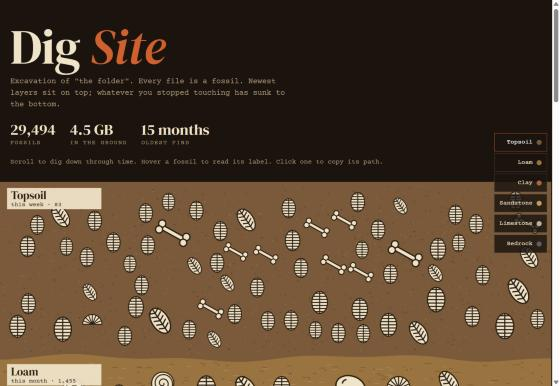
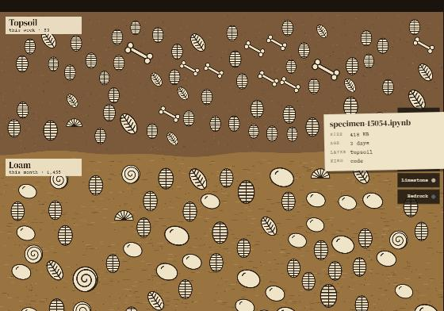

# Dig Site

> Your folder, excavated. Newest files on top, forgotten ones fossilised at the bottom.

Dig Site scans a folder and turns it into a **geological cross-section**. Every file becomes a fossil sitting in a rock layer chosen by how long ago it was last modified: **Topsoil** (this week) at the top, down through Loam, Clay, Sandstone and Limestone, to **Bedrock** (older than three years). Big files are big fossils, and the shape of each fossil tells you the kind of file. You scroll down through your own history, hover a fossil to read its specimen label, and find out what you stopped touching years ago.

It reads **only file names, sizes and dates** and never opens a file's contents. The result is one self-contained HTML page you open straight from disk.



---

## Contents

- [Highlights](#highlights)
- [Quick start](#quick-start)
- [Command-line options](#command-line-options)
- [Reading the dig](#reading-the-dig)
- [How it works](#how-it-works)
- [Project structure](#project-structure)
- [Testing](#testing)
- [Security & privacy](#security--privacy)
- [Accessibility](#accessibility)
- [Known limitations](#known-limitations)
- [Roadmap](#roadmap)
- [Skills & methodology](#skills--methodology)
- [License](#license)

---

## Highlights

| Feature | What you get |
|---|---|
| **Strata by age** | Six rock layers (Topsoil to Bedrock), each with its own texture, sized by how many files it holds. |
| **Fossils by file type** | Archives are ammonites, images are scallop shells, documents are leaves, code is trilobites, media is bones, everything else is a pebble. |
| **Specimen labels** | Hover a fossil for a cream museum-style card: size, age, layer, kind and path. Click to copy the path. |
| **Carbon dating** | The footer names your oldest file and your biggest boulder. |
| **Depth gauge** | A side rail jumps between layers and follows you as you scroll. |
| **Ledger** | A plain table of the 25 oldest and 25 biggest files, so nothing depends on the picture alone. |
| **Share-safe mode** | `--anonymize` replaces every name and path and makes the page contact nothing on the internet. |
| **Honest scan** | If the file limit cuts the scan short, the page says so at the top. |



## Quick start

**Requirements:** Node.js 18 or newer. No packages to install, no build step.

```bash
git clone https://github.com/sirajahmedshaikh454-dev/dig-site.git
cd dig-site
node cli.js "C:\Users\you\Downloads" --open
```

It prints a short summary in the terminal, writes `dig-site.html` and, with `--open`, opens it in your browser. With no folder given it digs into your **Downloads** folder (or the current folder if there isn't one).

## Command-line options

```bash
node cli.js [folder] [--out file.html] [--anonymize] [--open] [--max N] [--force]
```

| Option | Default | Description |
|---|---|---|
| `folder` | `~/Downloads` | The folder to excavate (up to 6 levels deep). |
| `--out file.html` | `./dig-site.html` | Where to write the page. Must end in `.html`. |
| `--anonymize` | off | Replace names and paths with `specimen-0001`, keep only well-known extensions, and build a page that makes **no network request**. Use this before sharing a page or a screenshot. |
| `--open` | off | Open the page in your default browser when done. |
| `--max N` | `50000` | Most files to read (100 to 200,000). If it is reached, the page shows a warning. |
| `--force` | off | Overwrite an existing `--out` file even if it isn't a Dig Site page. |

Bad arguments (`--out` with no value, `--max abc`, a folder that doesn't exist) exit with a clear message, never a stack trace.

## Reading the dig

| Layer | File last modified | Texture |
|---|---|---|
| Topsoil | within 7 days | speckles |
| Loam | within 30 days | short dashes |
| Clay | within 90 days | long lines |
| Sandstone | within a year | stipple dots |
| Limestone | 1 to 3 years ago | brick pattern |
| Bedrock | older than 3 years | diagonal hatching |

Each fossil's size grows with the file size on a log scale, so one huge installer does not hide everything else. Per layer, the **70 biggest** files are drawn as fossils and the rest appear as small grains. Placement is seeded by the file path, so the same folder always looks the same.

## How it works

```
folder ──► scan.js ──► files [{name, path, size, mtime}]
                          │
                          ▼
                     strata.js ──► layers, oldest, biggest, labels
                          │
                          ▼
   embed.js ──► one HTML file = template.html + data (as safe JSON)
                              + strata.js (inlined) + page.js
                          │
                          ▼
              page.js draws the canvas, labels, gauge and ledger
```

- **`scan.js`** streams each directory with `opendir`, so a folder with millions of entries is never loaded whole. It uses only `lstat`, skips symbolic links and junctions, skips `node_modules`, `.git`, `$RECYCLE.BIN`, `System Volume Information` and `AppData`, and counts folders it cannot read.
- **`strata.js`** is pure logic with no I/O: age buckets, fossil kinds, size and age labels, deterministic hashing. The Node tools import it, and `embed.js` also inlines it into the page (with `export` stripped) so the page needs no server and works from `file://`.
- **`embed.js`** builds the page. File data is embedded as JSON with `<` and the two JavaScript line-separator characters escaped, so a hostile file name cannot close the script tag.
- **`page.js`** lays out one band per layer, places fossils with overlap rejection, draws everything on a canvas, and builds all text with `textContent` (never `innerHTML`).

## Project structure

```
dig-site/
├── cli.js             # arguments, scan, terminal summary, safe write
├── scan.js            # read-only streaming folder walk
├── strata.js          # pure logic, shared by Node and the page
├── embed.js           # builds the self-contained page
├── template.html      # page shell and styles (dusk-lit field-notebook look)
├── page.js            # canvas, hover cards, gauge, ledger, easter egg
├── test.js            # unit tests: strata, formatting, scanner
├── hardening.test.js  # security, CLI and boundary tests
├── docs/              # screenshots (from an anonymised run)
└── package.json       # npm start / npm test, no dependencies
```

## Testing

```bash
npm test
```

**12 tests** cover:

- **Age buckets** at every boundary, including files "modified in the future", plus the oldest and biggest finds and an empty folder.
- **Labels:** `59 days`, `2 months` (never "1 months"), `1 MB` (never "1024 KB"), and files with odd names such as `x.constructor` or a bare `zip`.
- **Scanner:** reads metadata only, skips `node_modules`, never follows links, survives a missing folder, and sets the "limit reached" flag only when a real extra file was refused.
- **Hostile names:** a file called `</script>` produces a page with exactly one closing script tag, the whole inlined script still parses, and names round-trip exactly.
- **Anonymising:** no part of a real name survives, not even in the extension.
- **Network privacy:** the shared page contains no Google Fonts reference and carries a strict Content-Security-Policy.
- **CLI end to end:** bad arguments give messages, the tool overwrites its own pages, and it refuses to overwrite someone else's `.html` unless `--force`.

**Also checked in a real browser** with a fixture covering all six layers: no console errors, the fonts still load under the Content-Security-Policy, the hover card works for odd file names, the canvas matches the layout width, the gauge follows every layer (see the bug list below), a 375 px phone width has no sideways scroll, and the anonymous page makes no external request.

## Security & privacy

- **Metadata only.** It calls `opendir` and `lstat`. No file is ever opened or read.
- **No injection.** Names reach the page only as escaped JSON and `textContent`. A security review, run as an independent subagent, tried hostile names (`</script>`, quotes, backticks, `${7*7}`, line separators) against the real CLI and found no breakout.
- **`--anonymize`** removes names, paths, the folder name and unknown extensions, and builds a page with **zero** network requests. The review caught that an unusual extension (a name like `a.some private words`) could have leaked through, which is now fixed.
- **Content-Security-Policy** on every page: default deny, inline script and styles only; the normal page may additionally load its two Google fonts. Even injected script could not phone home.
- **Safe writing.** It will not overwrite a link or a file that isn't a Dig Site page (checked by a marker, not just the file name) without `--force`, and write errors are reported plainly.
- **Bounded.** Depth is capped at 6, files at `--max`, and directories are streamed.
- **The output page contains your file paths** (unless anonymised). Treat `dig-site.html` like any other private document. It is listed in `.gitignore` so it can't be committed by accident.

## Accessibility

- The canvas is described, and a **real HTML ledger table** lists the oldest and biggest files.
- Layer jumps are real buttons with labels and visible focus rings; touch targets are 44 px on phones.
- No scroll-jacking, no parallax and no animation to switch off: the picture is static, and scrolling is plain page scrolling.
- Colour is never the only signal: each layer is labelled in text, and file kinds are shown by shape and written in the hover label.

## Known limitations

- Age means **last-modified time**, which copying, cloning or syncing can reset. A folder you recently cloned looks young even if its contents are old.
- Only the 70 biggest files per layer are drawn as fossils; the rest are grains. The ledger and the counts include everything.
- There's no keyboard way to read an individual fossil's label yet (the ledger is the keyboard-friendly alternative).
- Developed and tested on Windows 11 in a Chromium-based browser. Linux, macOS, Windows junction points and other browsers are untested.
- The page is generated once: it is a snapshot, not a live view.

## Roadmap

- [ ] Keyboard navigation between fossils.
- [ ] Compare two digs of the same folder ("what sank since last month").
- [ ] Group by folder as well as age.
- [ ] A **"clean up"** helper that writes a list of the oldest, biggest files (never deletes anything itself).

## Skills & methodology

**How it was built**

1. **Research, then pitch three, build one.** The idea was chosen for being useful (finding forgotten junk), visual, and unlike the earlier builds. Rock-layer conventions came from a web search of the US geological-mapping standard (FGDC lithology patterns), used as inspiration for one texture per layer.
2. **Pure core first, with tests.** The age buckets, labels and the scanner were written and tested before any page code.
3. **A working version first, then layers.** An end-to-end build (scan to page) was verified in a browser before polishing: fossils, hover cards, gauge, ledger, then the easter egg.
4. **One commit per change**, pushed straight away, with the reasoning in the commit message.
5. **Three independent review passes, then fix everything:**
   - A **senior-engineer audit** (the *ponytail-audit* plugin) found 5 issues: a partial scan presented as complete, an untested security-critical function, silent overwriting of files, a dead parameter, and a false "limit reached" warning.
   - A **security review** and a **code review** ran as two read-only subagents in parallel (the built-in security-review skill needs the session to sit inside a git repo, so subagents did the same job). They found about a dozen more issues, including a privacy leak through file extensions, Google Fonts contacted by "anonymous" pages, prototype-name crashes, and several argument-handling and rounding bugs.
6. **Verification in a real browser**, at desktop and phone width, with a fixture covering all six layers. That caught one more real bug the reviews missed: **the last layer could never become active in the depth gauge**, because the page could not scroll far enough.

**Skills, plugins and tools used**

| Tool | Used for |
|---|---|
| **ui-ux-pro-max** design plugin | Searched for design-system and scroll-UX guidance. Its generic "enterprise" template did not fit, so it was rejected; its rules (no scroll-jacking, reduced-motion, an accessible alternative to the canvas) were kept. |
| **ponytail-audit** (senior-engineer plugin) | Whole-repo audit; all 5 findings fixed. |
| **Security and code review subagents** | Independent, read-only reviews running in parallel. |
| **Web search** | Geological-map conventions for the layer textures. |
| **Plugin catalog search** | Looked for token-saving and review plugins; the useful ones were already installed, and community plugins that hook every prompt were deliberately not installed. |
| **Built-in browser** (viewport emulation and page scripting) | Layout, hover, gauge, CSP and network checks. |
| **Node.js `node:test`** | The 12 tests. No other dependencies. |

**Bugs found and fixed during the build:** a test written with wrong date arithmetic, a JSON-escaping line corrupted by tooling, mis-sized gauge touch targets, the audit, security and code-review findings above, and the unreachable Bedrock layer.

## License

MIT

---

<details>
<summary>Spoiler: the easter egg</summary>

Type **rex** anywhere on the page. Your single biggest file turns into a **Tyrannosaurus skull** and its label reads *Tyrannosaurus Archivus*. Type it again to put it back.

</details>
